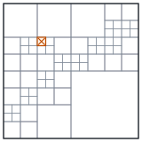

<picture>
  <source media="(prefers-color-scheme: dark)" srcset="assets/tiling-dark.svg">
  
</picture>

I study physics and astronomy at the University of Washington. Most of my research is time-domain astronomy: getting LSST alerts out of community brokers, checking that what arrived matches what was sent, and only then asking what the sky was doing. I do this as an undergraduate researcher in UW Astronomy, advised by Željko Ivezić, and presented early results at the Rubin Community Workshop at SLAC in July 2026.

I also work on optically pumped magnetometer (OPM) MEG, advised by Samu Taulu, through UW I-LABS and Aalto University. That work is not on GitHub.

#### Alert pipelines

The same LSST alert stream reaches me through two brokers that select and package it differently. I keep one pipeline per broker and do not merge them.

**[ANTARES_Analysis](https://github.com/darim1151/ANTARES_Analysis)** 
Night-by-night extraction of LSST-associated loci from ANTARES. Its search caps each query at about 10,000 results, so the pipeline tiles each night in time, RA and Dec, splits any tile that reaches the cap, and will not certify a night while a tile is still saturated. It has processed 90 nights between 25 February and 26 June 2026. [SkyPulse](https://sky-pulse-theta.vercel.app) is a static map built from one of its exports.

**[Fink_Alerts-Analysis-LSST](https://github.com/darim1151/Fink_Alerts-Analysis-LSST)** 
Bulk deliveries from Fink, accepted only when three counts agree: messages in the broker's topic, messages committed during transfer, and rows readable on disk. The validated cohort holds 7,101,947 alerts in 71,042 Parquet files from 25 February to 13 July 2026, though only 68 of those 139 days had any data delivered.

#### Notes from the alert work

- When a search caps out at about 10,000 results, the cheapest test is to ask for one day and then for 947 days. If both come back the same size, you are measuring the cap.
- One of the more useful runs failed. A test run for the night of 7 July was handed an `http://` pagination link by an HTTPS endpoint and stopped instead of following it.
- Of the 139 days requested from Fink, 71 came back empty. That describes the delivery, not the sky.

#### Other work

- **Plasma physics.** A working note on helicon-to-capacitive mode transitions, following Bevier & Little, *Phys. Rev. Research* **8**, 023177 (2026). Starting Winter 2027: research with the PLASMAWISE Lab at UW.
- **Spacecraft modeling.** Reproduced the open-source trajectory and solar-electric propulsion models of the Fermi Explorer Mission, a nonprofit's planned probe to Alpha Centauri, in Python, and tested them adversarially.
- **Before UW.** Fe₃O₄ nanoparticle synthesis and characterization (SEM/EDX, XRD, FTIR, BET, VSM) and UV-Vis adsorption kinetics.

The drawing at the top is a schematic of how ANTARES_Analysis divides a night: tiles that reach the result limit are split, and if one still reaches it at the smallest size, the night stays uncertified. · mdarim@uw.edu
